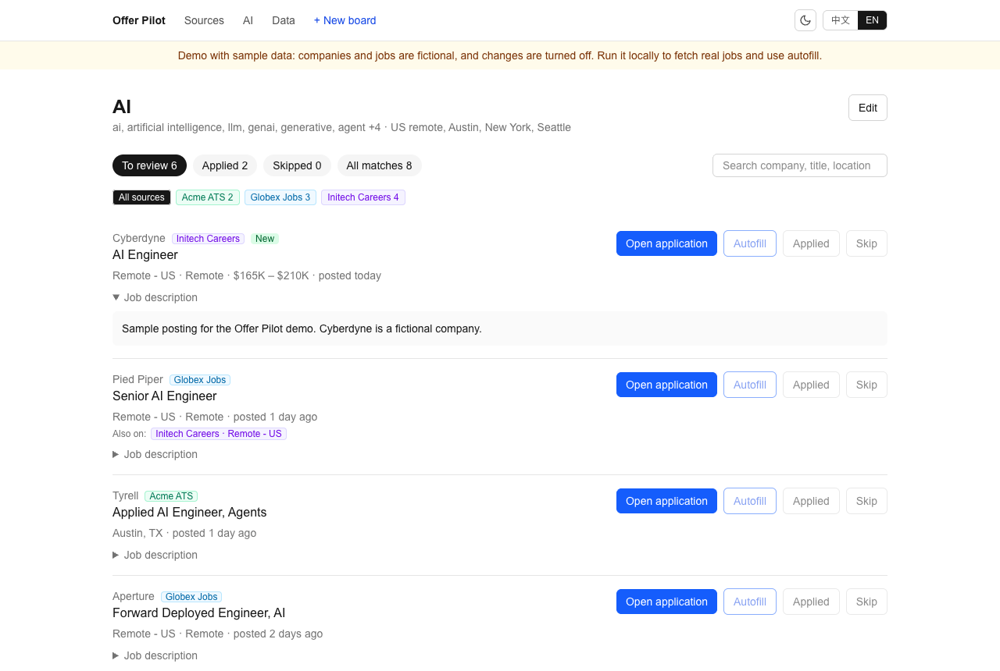
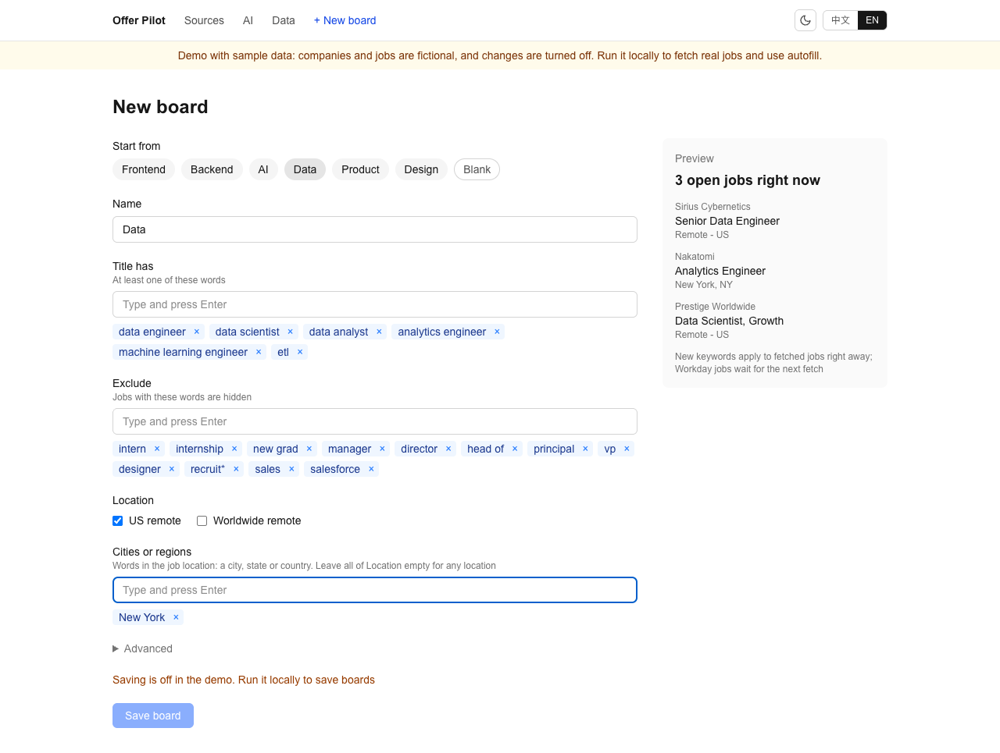
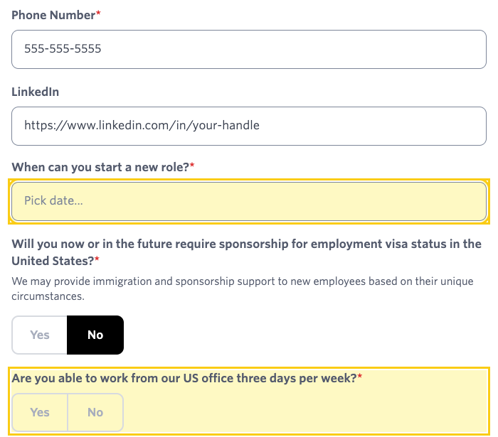
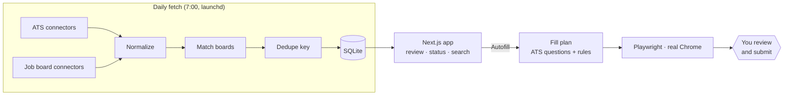

# Offer Pilot

[](https://github.com/cruilnsy/offer-pilot/actions/workflows/ci.yml)
[](LICENSE)


**English** | [中文](README.zh-CN.md) | **[Live demo](https://offer-pilot-seven.vercel.app)**

A semi-automatic job search tool. Every morning it pulls new postings from public ATS APIs and job boards, filters and dedupes them into one list, and when you pick a job it fills the application form in real Chrome — then stops, so **you** review and click Submit.



## Features
- **Your own sources, one list**: each user adds their own sources, and a macOS LaunchAgent fetches them every day
- **Your own job boards**: name a board, pick a template or type keywords and locations, and see matching jobs live while you edit. No code or regex
- **Cross-source dedupe**: the same job on several boards or in several cities becomes one row, and its status is shared
- **Autofill in real Chrome**: fixed fields → rule-matched common questions → everything uncertain is **highlighted** for you; it **never submits**
- **Sources you manage**: add connectors, turn them on or off, track companies, and keep a list of sites you check by hand, all on the Sources page
- **Status tracking**: To review / Applied / Skipped, search and per-source filters
- **Light and dark themes** and a **Chinese / English UI** with type-checked dictionaries (English by default)





## How it works

- **Fill plans are built before the browser opens**: each connector reads the form's questions up front, which makes plans printable (`--dry-run`) and unit-testable.
- **The runner** knows only a few field kinds (text, file, native select, combobox, radio/checkbox/yes-no buttons), so a new ATS is mostly a new planner.

## Try the demo
**[Open the live demo](https://offer-pilot-seven.vercel.app)**: fictional data, read-only. To run it yourself, no setup beyond `pnpm install`: fictional companies in an in-memory database, read-only. It never touches `data/jobs.db`.
```bash
pnpm install && pnpm demo   # http://localhost:3000/boards/ai
```
To host it (Vercel or similar), set `OFFER_PILOT_DEMO=1`. Fetching and autofill need a local run.

## Quick start
Requires Node 22+, pnpm and Google Chrome.
```bash
git clone https://github.com/cruilnsy/offer-pilot.git && cd offer-pilot
pnpm install
pnpm db:push                                              # create the local SQLite database (data/jobs.db)
cp data/profile.example.json data/profile.json  # your details for autofill (git-ignored)
cp data/sources.example.json data/sources.json  # your sources (git-ignored)
cp data/companies.example.json data/companies.json  # companies to fetch (git-ignored)
pnpm dev                                                  # http://localhost:3000: add sources, then create your first board
pnpm fetch-jobs                                           # first fetch, about 3 minutes
```
Add your sources and a board before the first fetch: fetching keeps descriptions only for jobs on a board, and some sources are searched with your boards' keywords.

Optional: `pnpm schedule:install` fetches every day at 7:00. The full walkthrough is in the [user guide](docs/guide.md).

`data/sources.json` and `data/companies.json` are yours. The templates hold fictional samples, so replace them: a source's `id` must match a connector in `src/lib/ats`, and a company's `ats` is the `id` of its source.

## Project structure
| Path | Contents |
|---|---|
| [docs/guide.md](docs/guide.md) | **User guide**: running the app, fetching jobs, the semi-automatic application flow and autofill ([中文](docs/guide.zh-CN.md)) |
| `src/` | The Next.js app: pages in `src/app`, fetching and autofill in `src/lib` |
| `scripts/` | Command-line tools: `fetch-jobs`, `autofill`, the daily schedule |
| `tests/` | Unit, browser and i18n tests |
| `docs/` | User guide and README screenshots |
| `.github/workflows/ci.yml` | CI: typecheck, lint, tests, build, gitleaks |
| `data/` | Local only (git-ignored): database, your profile, your company list, resume, logs. Only the two `*.example.json` templates are committed |

## Daily use
```bash
pnpm fetch-jobs     # 1. fetch the latest jobs from every direct source (about 3 minutes; also runs daily at 7:00)
pnpm dev            # 2. start the web app at http://localhost:3000 (home is "Sources"; your boards are in the top navigation)
```
In the web app:
- **New board** creates a board; **Edit** on a board changes its rules or deletes it (jobs and their status are kept)
- A board → **To review**: new, matching jobs. Click a title for the original posting, expand "Job description" for details
- **Open application** opens the company's application page in a new tab; **you review and submit**
- **Autofill** opens the application in Chrome and fills what it can (see below)
- After applying click **Applied**; otherwise **Skip**; use **Undo** in the matching tab to revert
- Search company, title and location in the top right; the row of badges filters by source
- **Sources** (`/`): **Add source** picks a connector, the switch turns it on or off, **Tracked companies** adds or removes companies, and **Workaround sources** is your own list of sites you check by hand
- The moon / sun button switches between light and dark (it follows your system until you click it); **中文 / EN** next to it switches the language

## Job sources
A new install has no sources: each user adds their own on the Sources page, and the choices stay in the git-ignored `data/sources.json`.
| Kind | What it is |
|---|---|
| **Direct** | Sources fetched daily. An ATS source fetches the companies you track; a job board source needs no company list |
| **Workaround** | Your own list of sites with no public API, with a status and a note for each. They are never scraped |

## Dedupe (`src/lib/dedupe.ts`)
The same job can appear on several sources (e.g. the same role on an ATS and a job board), or once per city (e.g. Wonka in San Francisco and New York).
- The dedupe key is the normalized company + title (ignoring case, punctuation, suffixes like Inc/LLC, and parentheses holding a location, "Remote" or a job number; **team names in parentheses are kept**, since different teams are different jobs)
- The page shows one row per group: the ATS posting first, with other sources or cities listed under "**Also on**"
- Marking "Applied / Skip" updates the whole group, and later postings of the same job inherit the status
- After changing the rules, run `pnpm check-dedupe`

### Autofill
- Click **Autofill** next to a job: a dedicated Chrome profile opens the application and fills what it can; **highlighted** fields are for you. Review and **submit yourself**: the tool never clicks Submit
- From the command line: `pnpm autofill <job id | application URL>`; add `--dry-run` to print the fill plan without opening a browser
- Your details live in `data/profile.json` (git-ignored; format in `data/profile.example.json`); fields set to `TODO(confirm)` are never filled
- Resume PDF: put it in `data/resume/` and point `resumePath` in `profile.json` at it (re-export after every resume change)
- Log: `data/autofill.log`

Fill layers: fixed fields → rule-matched common questions (`src/lib/autofill/rules.ts`) → everything else highlighted. Follow-ups ("If yes, …") and location-dependent questions are never guessed.

### Chinese / English UI
- The UI is in English by default; toggle with **中文 / EN** in the top-right corner; the choice is stored in the `lang` cookie and URLs stay the same
- All UI text is in `src/i18n/dictionaries.ts`: Chinese defines the shape and English must match it key for key (`tests/i18n.test.ts` also checks the English UI has no Chinese left)

### Scheduled fetching
- `pnpm fetch-jobs` runs every day at 7:00 (macOS LaunchAgent `com.offerpilot.fetch`); log in `data/fetch.log`
- Install / remove: `pnpm schedule:install`, `pnpm schedule:uninstall`. A fetch takes about 3 minutes

### Tests
- `pnpm test`: all tests (unit tests, browser tests in headless Chrome against local copies of the forms, i18n checks; browser tests need Google Chrome)
- `pnpm test:unit`, `pnpm test:browser`: run them separately
- `pnpm build && pnpm test:e2e`: board flows end to end in real Chrome, on a temporary database
- `pnpm typecheck`: generates Next.js route types, then runs `tsc --noEmit`
- **CI** (`.github/workflows/ci.yml`): every push and pull request runs typecheck, lint, the filter and dedupe rule checks, all tests (browser tests in the runner's Chrome), a production build and the end-to-end tests; a second job scans the whole git history with gitleaks

⚠️ If port 3000 is taken (`EADDRINUSE`), use `pnpm dev -p 3100`.

## Boards (`src/lib/filter.ts`)
A board is a saved search, stored in the local database. Which jobs match is worked out when a page loads, so a new board shows already fetched jobs right away.
- **Title has** / **Exclude** / **Title must also have** (under Advanced): plain words or phrases. Case and punctuation do not matter, `front end` equals `frontend`, plurals match, and a trailing `*` matches a prefix (`recruit*`)
- **Location**: US remote, worldwide remote, and any words in the job location (a city, state or country). Leave all of it empty for any location
- **Templates** (`src/lib/board-templates.ts`): Frontend, Backend, AI, Data, Product, Design
- Very large sources are searched by keyword, so new keywords reach them on the next fetch. Sources are limited to `data/companies.json`, so add the companies your field hires at

## Tech stack
Next.js 16 (App Router, Cache Components) + React 19 + TypeScript + Tailwind CSS 4 + SQLite (better-sqlite3 + Drizzle ORM) + Playwright (autofill) + node:test (tests)

## License
[MIT](LICENSE) © cruilnsy
