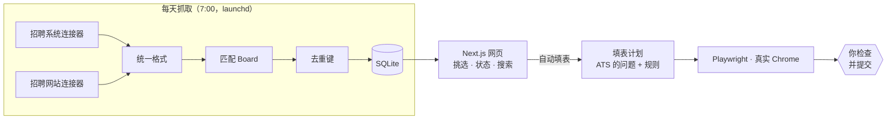

# Offer Pilot（半自动投递工具）

[](https://github.com/cruilnsy/offer-pilot/actions/workflows/ci.yml)
[](LICENSE)

[English](README.md) | **中文**

每天早上从招聘系统的公开接口和招聘网站抓取新职位，筛选、去重后合并成一个列表；选中一个职位后，在真实的 Chrome 里自动填好申请表，然后停下来，由**你自己**检查并点提交。


## 功能
- **自己的来源，一个列表**：每个用户添加自己的来源，macOS LaunchAgent 每天抓取
- **自定义职位 Board**：起个名字，选模板或输入关键词和地点，编辑时实时看到匹配的职位，不用写代码或正则
- **跨来源去重**：同一个职位出现在多个网站或多个城市，合并成一行，状态共用
- **真实 Chrome 自动填表**：固定字段 → 规则匹配常见问题 → 没把握的**标黄**交给你；**永远不点提交**
- **自己管理来源**：在来源页添加连接器、开关来源、增删跟踪的公司，并维护手动查看的网站清单
- **投递状态**：待处理 / 已投递 / 已跳过，支持搜索和按来源筛选
- **浅色 / 深色主题**和**中英文界面**：词典有类型检查，默认英文


## 工作原理

- **填表计划在打开浏览器之前就生成好**：每个连接器先读取表单的问题，所以计划可以先打印出来看（`--dry-run`），也方便单元测试。
- **执行器**只认几种字段（文本、文件、原生下拉框、可搜索下拉框、单选 / 多选 / 是否按钮），所以加一家新的 ATS，主要是写一个新的计划生成器。

## 试用演示版
只要 `pnpm install`，不用其他配置：虚构的公司，存在内存数据库里，只读，不会碰 `data/jobs.db`。
```bash
pnpm install && pnpm demo   # http://localhost:3000/boards/ai
```
部署到 Vercel 等平台时，设置环境变量 `OFFER_PILOT_DEMO=1`。抓取职位和自动填表需要在本地运行。

## 快速开始
需要 Node 22+、pnpm 和 Google Chrome。
```bash
git clone https://github.com/cruilnsy/offer-pilot.git && cd offer-pilot
pnpm install
pnpm db:push                                              # 创建本地 SQLite 数据库（data/jobs.db）
cp data/profile.example.json data/profile.json  # 自动填表用的个人资料（不进 Git）
cp data/sources.example.json data/sources.json  # 你的来源（不进 Git）
cp data/companies.example.json data/companies.json  # 要抓取的公司（不进 Git）
pnpm dev                                                  # http://localhost:3000：先添加来源，再建第一个 Board
pnpm fetch-jobs                                           # 第一次抓取，大约 3 分钟
```
先添加来源和 Board，再抓取：抓取时只保存 Board 匹配职位的描述，部分来源也是用 Board 的关键词搜索的。

可选：`pnpm schedule:install` 每天 7:00 自动抓取。完整步骤见[使用指南](docs/guide.zh-CN.md)。

`data/sources.json` 和 `data/companies.json` 是你自己的。模板里是虚构样例，要换成你自己的：来源的 `id` 要和 `src/lib/ats` 里的连接器一致，公司的 `ats` 是它所属来源的 `id`。

## 项目结构
| 路径 | 内容 |
|---|---|
| [docs/guide.zh-CN.md](docs/guide.zh-CN.md) | **使用指南**：怎么运行、抓取职位、半自动投递和自动填表（[English](docs/guide.md)） |
| `src/` | Next.js 项目：页面在 `src/app`，抓取和自动填表在 `src/lib` |
| `scripts/` | 命令行工具：`fetch-jobs`、`autofill`、定时任务 |
| `tests/` | 单元测试、浏览器测试、中英文词典测试 |
| `docs/` | 使用指南和 README 截图 |
| `.github/workflows/ci.yml` | CI：类型检查、lint、测试、构建、gitleaks |
| `data/` | 只在本地（不进 Git）：数据库、个人资料、公司名单、简历、日志。只有两个 `*.example.json` 模板进 Git |

## 每天怎么用
```bash
pnpm fetch-jobs     # 1. 抓取所有可拉取来源的最新职位（大约 3 分钟）
pnpm dev            # 2. 启动网页，打开 http://localhost:3000（主页是"来源"，你的 Board 在顶部导航）
```
网页上：
- **新建 Board** 创建 Board；Board 页面的**编辑**可以修改规则或删除（职位和投递状态都会保留）
- 打开一个 Board 的**待处理**：新的、符合条件的职位。点职位名称看原文，展开"职位描述"看详情
- **打开申请页**：在新标签页打开公司的申请页面，**你自己确认后提交**
- 投完点 **已投递**；不合适的点 **跳过**；点错了到对应的标签页里点 **撤销**
- 右上角可以搜索公司、职位、地点；下面一排标签可以**按来源筛选**
- 主页 **来源**（`/`）：**添加来源**选择连接器，开关控制抓不抓，**跟踪的公司**可以增删公司，**不可拉取的来源**是你自己手动查看的网站清单
- 月亮 / 太阳按钮切换浅色和深色（没点过时跟随系统）；旁边的 **中文 / EN** 切换语言

## 职位来源
新安装时没有任何来源：每个用户在来源页添加自己的，选择保存在不进 Git 的 `data/sources.json`。
| 类别 | 说明 |
|---|---|
| **可拉取** | 每天抓取的来源。招聘系统类型抓你跟踪的公司，招聘网站类型不需要公司名单 |
| **不可拉取** | 没有公开接口的网站，由你自己维护清单，可写状态和备注，程序不抓取 |

## 去重（`src/lib/dedupe.ts`）
同一个职位可能出现在多个来源（例：同一个职位同时在招聘系统和招聘网站上），或者同一家公司在不同城市各发一次（例：Wonka 在旧金山、纽约）。
- 用"规范化的公司名 + 职位名"作为去重键（忽略大小写、标点、Inc/LLC 等后缀，以及括号里的地点、Remote、职位编号；**括号里的团队名保留**，不同团队是不同职位）
- 网页上合并成一行：主行优先用招聘系统那一条，下面"**也在**"列出其他来源或城市的链接
- 标记"已投递 / 跳过"时，同一组一起改；以后新出现的同一个职位会自动继承这个状态
- 改了规则以后跑 `pnpm check-dedupe`

### 自动填表
- 职位右边点 **自动填表**：用专用的 Chrome 打开申请页，自动填好能填的项，**标黄**的项要你自己填；检查后**自己点提交**，程序永远不点提交
- 命令行也可以：`pnpm autofill <职位 id 或申请页链接>`；加 `--dry-run` 只打印"会怎么填"，不打开浏览器
- 个人资料在 `data/profile.json`（不进 Git，格式见 `data/profile.example.json`）；写着 `TODO(confirm)` 的项不会自动填
- 简历 PDF：放在 `data/resume/`，`profile.json` 的 `resumePath` 指向它（简历更新后要重新导出 PDF）
- 运行日志：`data/autofill.log`

### 中英文切换
- 网页默认显示英文；右上角 **中文 / EN** 按钮切换，选择存在 cookie `lang` 里，网址不变
- 文案都在 `src/i18n/dictionaries.ts`，中文版定义结构，英文版必须一一对应（测试 `tests/i18n.test.ts` 也检查英文版里没有中文）

### 定时抓取
- 每天早上 7:00 自动运行 `pnpm fetch-jobs`（macOS LaunchAgent `com.offerpilot.fetch`），日志在 `data/fetch.log`
- 安装 / 卸载：`pnpm schedule:install`、`pnpm schedule:uninstall`。抓取大约要 3 分钟

### 测试
- `pnpm test`：全部测试（自动填表的单元测试 + 浏览器测试，浏览器测试要装 Google Chrome）
- `pnpm test:unit`、`pnpm test:browser`：分开跑
- `pnpm build && pnpm test:e2e`：在真实 Chrome 里跑完整的 Board 流程，用临时数据库
- `pnpm typecheck`：先生成 Next.js 的路由类型，再运行 `tsc --noEmit`
- **CI**（`.github/workflows/ci.yml`）：每次 push 和 PR 都跑类型检查、lint、筛选和去重规则检查、全部测试（浏览器测试用 CI 机器自带的 Chrome）、生产构建和端到端测试；另一个任务用 gitleaks 扫描整个 git 历史

⚠️ 如果 3000 端口被占用（`EADDRINUSE`），用 `pnpm dev -p 3100`。

## Board（`src/lib/filter.ts`）
Board 就是一个保存好的搜索，存在本地数据库。打开页面时才计算匹配结果，所以新建的 Board 马上能看到已抓取的职位。
- **标题包含** / **标题排除** / **标题还必须包含**（在"高级"里）：普通的词或词组。不分大小写，忽略标点，`front end` 等于 `frontend`，复数也能匹配，末尾加 `*` 匹配前缀（`recruit*`）
- **地点**：美国远程、全球远程，以及职位地点里的词（城市、州或国家）。全部不选表示不限地点
- **模板**（`src/lib/board-templates.ts`）：Frontend、Backend、AI、Data、Product、Design
- 太大的来源只能按关键词搜索，新关键词要等下次抓取才生效。来源只覆盖 `data/companies.json` 里的公司，要按自己的行业添加

## 技术栈
Next.js 16（App Router，Cache Components）+ React 19 + TypeScript + Tailwind CSS 4 + SQLite（better-sqlite3 + Drizzle ORM）+ Playwright（自动填表）+ node:test（测试）

## 许可证
[MIT](LICENSE) © cruilnsy
